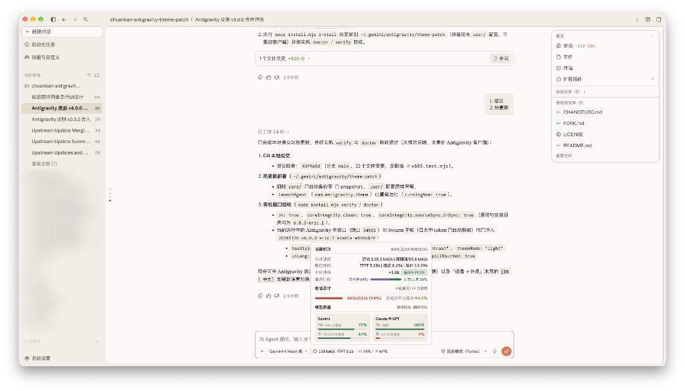
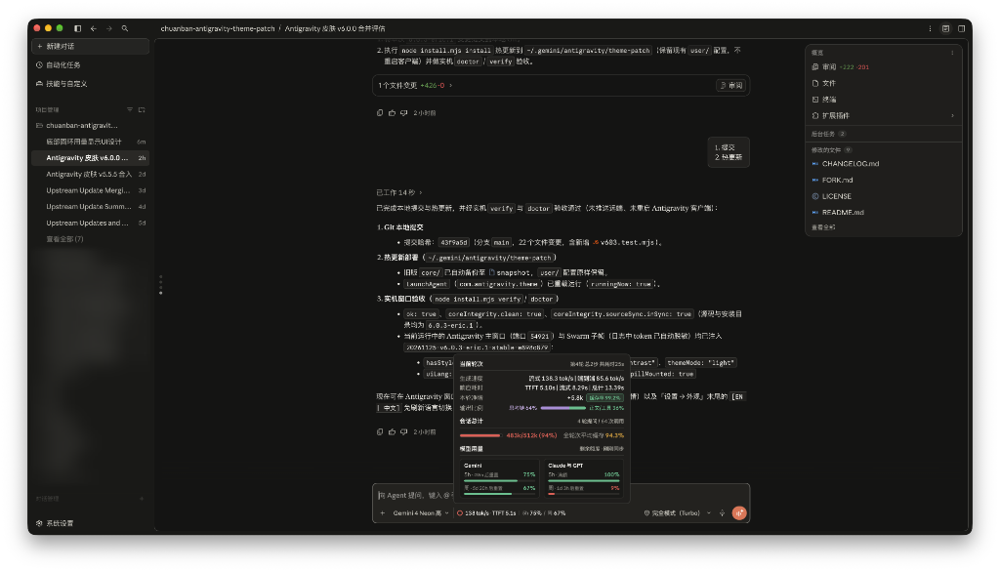
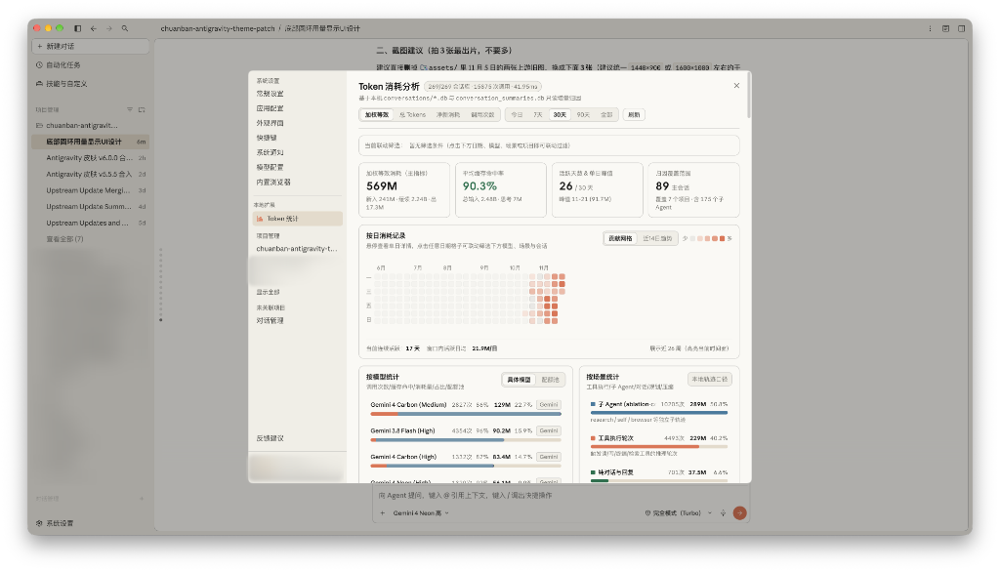

# Antigravity 暖纸主题与增强补丁（macOS）

`antigravity-parchment-theme` · `6.0.6-eric.1`

[](https://github.com/pumblus/antigravity-parchment-theme)
[](https://github.com/pumblus/antigravity-parchment-theme)
[-339933.svg)](https://nodejs.org/)
[](https://github.com/pumblus/antigravity-parchment-theme)
[](LICENSE)

> **致谢与上游说明**：本项目是基于 **[忒修斯的船板（@Anarcadia）的 `chuanban-antigravity-theme-patch`](https://github.com/Anarcadia/chuanban-antigravity-theme-patch)**（MIT 协议）构建的 **macOS 专用个人分支**，并非上游官方发布。
>
> 项目的核心架构——零构建 `core/` + `user/` 热重载分离设计、Browser 级 CDP 注入与目标发现、只读增量 SQLite 遥测与 Token 统计引擎、Swarm 跨域子帧同步、2,200+ 条母语级中文词典底座以及生命周期 CLI——**全部归功于船板（[@Anarcadia](https://github.com/Anarcadia)）及上游社区贡献者**。
>
> **如果你使用 Windows / WSL / Linux、偏爱上游的莫兰迪色与五段式主题切换器，或希望严格停留在「纯表层视觉 + 只读本地 SQLite」边界，请直接使用上游原版仓库：[`Anarcadia/chuanban-antigravity-theme-patch`](https://github.com/Anarcadia/chuanban-antigravity-theme-patch)。**

面向 **macOS 版 Google Antigravity（`2.36.0+`）** 的轻量暖纸/暖墨视觉重构、中文汉化、右键浮窗与 IDE 桥接、实时指标与底部模型配额增强补丁。供 AI Agent 读取的完整部署与改装规范见 **[`SKILL.md`](SKILL.md)**，与上游的逐版差异及审计记录见 **[`FORK.md`](FORK.md)**。

---

## 界面预览

### 1. 白天暖纸主界面 + 底部模型配额斜杠与悬浮双列卡


### 2. 黑夜暖墨黑工作台（Slate Dark）


### 3. 设置弹窗 → Token 消耗分析（本机只读 SQLite）


---

## 与上游的核心差异

本分支长期按个人审美与 macOS 日常工作流选择性同步上游改进，而非全量镜像：

| 维度 | 上游原版 [`chuanban-antigravity-theme-patch`](https://github.com/Anarcadia/chuanban-antigravity-theme-patch) | 本分支 `antigravity-parchment-theme` |
| :--- | :--- | :--- |
| **平台支持** | macOS / Windows / WSL2 / Linux 全平台 | **仅 macOS**（剔除跨平台、DirectWrite 与 WSL 代码，仅留 LaunchAgent） |
| **视觉体系** | 莫兰迪默认 + 五段式主题切换 + 系统自动跟随 + 润墨效果 | **类 Anthropic 扁平暖纸 / 暖墨黑**：零 `#FFFFFF`、零 `box-shadow`、零 `:has()`、macOS 同心超椭圆圆角，`#D97757` 仅保留给发送主按钮 |
| **字体排印** | Google Sans Flex / Anthropic / 更纱黑体 | **Anthropic 三族**（`Sans` / `Serif` / `Serif Display` / `Mono` 全字重与真斜体）+ 中文优先 **`PingFang SC`** |
| **底部模型配额** | 严格停留在纯视觉 + 本地 SQLite，配额由社区外部插件承接 | **内置底部配额显示**（`modules.quota` 可关）：胶囊右侧常驻 Gemini 极简斜杠 `5h X% / 周 Y%`，悬停卡底部追加 Gemini 与 Claude & GPT 双列余量与重置倒计时 |
| **未合入的上游能力** | 含自动重启接力（`relaunch`）、`--sync-user`、字体自动下载、外部中文标题脚本检查 | **均未带入**：保留原有 `user/` 字节不覆盖，不自动重启客户端，不调用仓库外外部脚本 |

---

## 主要特性（`6.0.6-eric.1`）

- **昼夜暖调双模式（扁平层叠、零纯白、零投影，支持 `modules.theme: false` 独立关闭）**：
  - **白天模式**：单一精调 Anthropic 官方标准暖羊皮纸配色（侧栏 `#F0EEE6` / 阅读区 `#FAF9F5` / 选中 `#E3DACC` / 暖墨字 `#141413` / `1px` 石色细边 `#CCCBC8`），并支持通过 `themeVars` 与 `user/custom.css` 微调。
  - **黑夜模式**：随客户端深色模式切换为暖墨黑反色配色（主背景 `#141413` / 侧栏 `#191917` / 卡片 `#1F1E1C` / 细边 `#3D3D3A` / 文字 `#FAF9F5`）。
  - **原生主题兼容模式**：在 `user/config.json` 将 `"modules": { "theme": false }` 即可彻底关闭视觉与字体覆盖，保留客户端自带的 Everforest / Nord / 默认主题，同时继续享用中文汉化、底部配额、实时指标、Token 统计与右键浮窗（控件自动继承原生主题配色）。
- **三段式样式隔离与三族字体排版**：拆分 `#ag-font-faces`、`#ag-custom-fonts` 与 `#ag-ui-widgets` 避免切主题或流式输出闪烁；正文采用 `Anthropic Serif`（首页欢迎语 `Anthropic Serif Display`），UI/输入框/指标采用 `Anthropic Sans`（配 `tabular-nums` 等宽数字），代码/路径/终端采用 `Anthropic Mono`；中文优先回退 `PingFang SC`。
- **2,258 条静态汉化 + 原生菜单汉化 + 外观 `[EN | 中文]` 免刷新切换**：保留上游词库基线与 `WeakMap` 正文/代码/Diff 隔离保护，覆盖 Antigravity `2.36.0`（含最大化侧栏浮动输入框状态条、跳过步骤、插件与组织策略提示）、Electron 原生右键菜单 `REV=3` 跨隔离世界汉化、Swarm 协作子帧与子 Agent 面板；可在「系统设置 → 外观」一键中英切换并写回 `user/config.json`。
- **仿 Claude 扁平右键浮窗卡片与 macOS 外部 IDE 桥接（`modules.contextMenu` 可关）**：接管对话正文、代码块（一键复制代码块）、外链、对话内图片（复制/另存）、文件胶囊与输入框右键菜单（`Shift + 右键` 随时透传原生菜单）；自动探测 `/Applications` 已安装主流 IDE（VS Code / Cursor / Windsurf / Zed / JetBrains / Sublime），支持文件胶囊一键跳行打开与本地 `.html/.pdf/.svg` 浏览器直开。
- **底部圆环指标胶囊 + 实时模型配额 + 冷热分层 Token 统计**：
  - 输入框底栏（含 `2.36.0` 浮动展开输入框）常驻紧凑圆环胶囊（支持 `metricsMode: "compact" | "full"`），展示生成速度（`tok/s` / `Hold`）、首字耗时（`TTFT`）、上下文水位与子 Agent 汇总；
  - 胶囊右侧常驻 **Gemini 剩余额度**（中文 `5h X% / 周 Y%`，英文 `5h X% / 7d Y%`；`≤25%` 琥珀预警、`≤10%` 砖红告警），解决 Agent 运行期间原生模型选择器锁死无法查看用量的问题；悬停展开详情卡可同时查看 **Gemini** 与 **Claude & GPT** 双列 5h/周余量、进度条与重置倒计时；
  - 「系统设置 → Token 统计」提供本机只读 SQLite 多维消耗归因、热力图与会话明细（支持 `[EN | 中文]` 双语，并采用冷/热分层磁盘索引缓存适配无限对话历史）。
- **内核与个人配置物理分离**：`core/` 只读升级，`user/` 永久保留且修改后约 `2.5s` 热重载生效；支持 `--safe-mode` 排查冲突、`rollback` 一键回滚与 `uninstall` 彻底卸载还原。

---

## 快速安装与升级

### 前置要求

1. **系统与运行时**：macOS + **Node.js `>= 22.0.0`**（推荐 **`>= 22.13.0`** 以启用 SQLite 实时指标与 Token 统计）。
2. **字体准备**：本仓库不打包闭源商业字体文件。如本机尚未安装 `Anthropic Sans` / `Anthropic Serif` / `Anthropic Mono`，请自行准备字体并安装至 `~/Library/Fonts/`（或使用 `node install.mjs install-fonts --from <字体目录>`）；未安装时界面会自动回退至 macOS 原生 `PingFang SC` 与系统字体族。
3. **Antigravity 2.33.0+ 本地调试端口**：客户端默认不再开放本地 CDP。本分支**不会**自动关闭或重启你的客户端；如 `doctor` 提示端口未就绪，请先保存工作后自行以 `--remote-debugging-port=0` 启动客户端。

### 交给 AI Agent 安装或升级

复制以下提示发给你的 AI Agent（Antigravity / Claude Code / Codex 等）：

> 请帮我克隆或拉取 `https://github.com/pumblus/antigravity-parchment-theme.git`，完整阅读仓库内的 `SKILL.md`。先运行 `node install.mjs doctor` 检查环境；取得我的本次安装权限确认后，执行 `node install.mjs install`（保留我现有的 `~/.gemini/antigravity/theme-patch/user/` 配置，不要自动重启客户端），端口就绪后运行 `node install.mjs verify` 完成验收。

### 常用维护命令

```bash
# 查看核心完整性、与源码同步状态、Node 与 CDP 诊断
node install.mjs doctor

# 安全模式验证（临时跳过 user/ 层定位自定义配置冲突）
node install.mjs verify --safe-mode

# 回滚到上一份有效 core 备份（兼容历史 chuanban 备份）
node install.mjs rollback

# 彻底卸载（停止后台服务并还原当前窗口样式与英文界面，保留 user/ 目录）
node install.mjs uninstall
```

> **从上游平滑切换说明**：本分支与上游共享安装目录 `~/.gemini/antigravity/theme-patch/` 与 LaunchAgent（`com.antigravity.theme`），两者**不可同时安装**；直接运行 `node install.mjs install` 会备份旧 `core/`、保留你原有的 `user/` 配置并完成切换，随时可通过 `rollback` 退回。

---

## 常用配置与开关（`user/config.json`）

所有个人定制仅修改 `~/.gemini/antigravity/theme-patch/user/`，保存后约 2.5 秒自动热重载，升级不覆盖：

```json
{
  "enabled": true,
  "channel": "auto",
  "preset": "high-contrast",
  "metricsMode": "compact",
  "modules": {
    "theme": true,
    "i18n": true,
    "metrics": true,
    "quota": true,
    "tokenAnalytics": true,
    "contextMenu": true,
    "composerWaxSeal": true,
    "deadlockHealer": true,
    "zoomShortcuts": true,
    "cdpEventDiscovery": true,
    "customCss": true,
    "customJs": true
  },
  "themeVars": {
    "--ag-chat-font-size": "16px"
  }
}
```

- **只用增强功能、保留官方原生主题**：将 `"modules": { "theme": false }` 写入 `user/config.json`，约 2.5 秒即可热切回原生皮肤（如 Everforest / Nord / 默认主题），同时保留汉化、配额、指标、Token 统计与右键浮窗。
- **关闭底部模型配额显示**：将 `"modules": { "quota": false }` 写入 `user/config.json` 即可在 2.5 秒内无损移除。
- **切换旧版长条指标胶囊**：将 `"metricsMode": "full"` 即可从圆环切回完整速率文字。
- **自定义样式 / 词条 / 脚本**：分别编辑 `user/custom.css`、`user/i18n.override.json`、`user/custom.js`（详见 [`SKILL.md`](SKILL.md)）。

---

## 技术边界与免责声明

- **严格红线**：本补丁绝不自动发送消息或操控对话流、不绕过模型配额或权限限制、不拦截或篡改网络请求、不读取或导出 OAuth 凭据、不修改客户端 `.asar` 安装包或二进制签名。
- **数据来源透明说明**：
  - 实时速度、上下文水位与 Token 统计来自**本机只读 SQLite**（`~/.gemini/antigravity/conversations/*.db`）；
  - 底部模型配额显示通过**只读遍历前端 React Fiber** 调用客户端自身已有的 `retrieveUserQuotaSummary()` 接口（事件驱动 + 全局 20 秒硬节流 + 2 分钟兜底轮询，后台标签页自动静默，Swarm 子帧禁用）。如果 Antigravity 大版本调整前端内部组件结构，该模块可能阶段性失效，届时不会影响主题与指标主体，也可随时通过 `modules.quota: false` 关闭。
- **合规免责**：本项目为非官方社区视觉与辅助补丁，与 Google 及 Anthropic 均无任何关联、背书或合作关系。鉴于商业软件服务条款（ToS）对运行时前端注入存在字面灰区，本项目按「现状（AS IS）」提供，请自行评估并承担使用风险，随时可通过 `node install.mjs uninstall` 完整还原。

---

## 致谢与开源协议

- 特别致谢 **[忒修斯的船板（@Anarcadia）](https://github.com/Anarcadia)** 创作并持续打磨 [`chuanban-antigravity-theme-patch`](https://github.com/Anarcadia/chuanban-antigravity-theme-patch)，为社区奠定了极高质量的零依赖热重载架构、SQLite 增量遥测引擎与母语级汉化词典。
- 感谢上游社区所有参与定位与共建的贡献者（包括但不限于 [@honlam996](https://github.com/honlam996)、[@webber181](https://github.com/webber181) 等）。
- 本项目沿用 **[MIT License](LICENSE)**，完整保留原作者版权声明。详细同步边界、验证范围与版本演进见 **[`FORK.md`](FORK.md)** 与 **[`CHANGELOG.md`](CHANGELOG.md)**。
